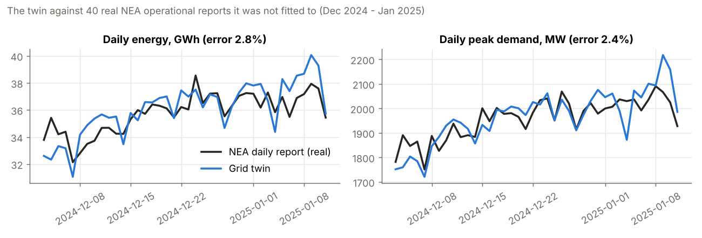
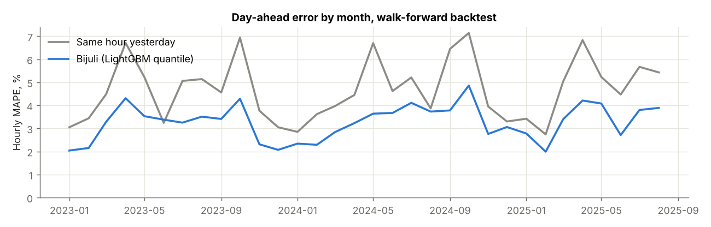
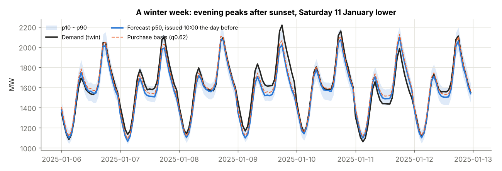
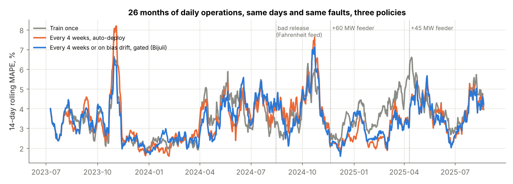
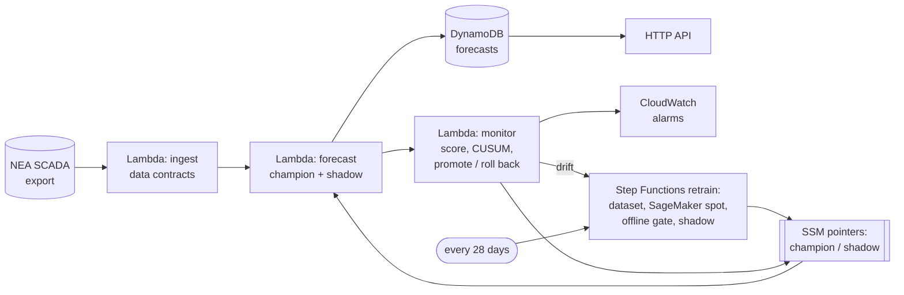

# Bijuli (बिजुली): day-ahead electricity demand forecasts for Nepal's grid, kept good for years

[](https://bijuli-nepal-grid-forecast.onrender.com)

Every morning, Nepal Electricity Authority's Load Dispatch Centre decides how much power to buy from India's day-ahead market for tomorrow, and bids close at 12:15. Bijuli forecasts national demand for each hour of tomorrow at 10:00. It also gives an honest uncertainty band and a purchase basis tilted by what a shortfall costs. Then, with no one retraining it by hand, it keeps that forecast good while demand grows, new industrial feeders connect and EVs spread. It does that without letting a broken model buy power.

The model is the small part of this project. **The MLOps is the project:** data contracts, a model registry, shadow rollout, automatic rollback and drift monitoring, measured over 26 months of simulated daily operations with real faults injected. The design is a serverless AWS stack costing about **$1.63 a month** (designed and tested against mocked AWS, not deployed).

```text
GET /forecast/2025-01-08

{"target_day": "2025-01-08", "version": "v018", "degraded": false,
 "p50": [1369, 1258, 1154, ... 2074, 2071, 1934, ...],   MW, hours 00-23
 "p10": [1305, ...], "p90": [1436, ...],
 "bid": [1388, ... 2105, 2097, ...]}                      purchase basis (q0.62)
```
*(The API's response shape, filled with the backtest forecast for 8 January 2025, issued at 10:00 on 7 January. The 17:00 peak was forecast at 2,074 MW. The twin's "actual" was 2,063 MW. v018 was the champion that day in the replay.)*

> **Read this first: what is real and what is simulated.** The weather is real: NOAA hourly observations from 6 Nepali airports, 2022 to 2025. NEA's published monthly energy and peak tables are real, and so are 40 daily operational reports. The **hourly national load is simulated** by a "grid twin" calibrated to those NEA tables, because NEA's hourly data was not reachable from where I built this ([why](data/README.md#why-the-load-is-simulated)). The twin is validated against the 40 real days it was not fitted to. Every other component would run unchanged on real SCADA data.

## The problem

Nepal's grid has two seasons. In the monsoon, run-of-river hydro produces more than Nepal uses, and NEA exports: 564 GWh in Bhadra alone in FY 2081/82. In the dry season, rivers fall while demand stays high, and NEA imports from India through the day-ahead market on IEX: over 350 GWh a month from Falgun to Baishakh. Demand peaks twice: winter evenings (heating, lights after sunset) and the pre-monsoon heat in the Terai, which set the year's record of 2,409 MW in Jestha (June 2025). Those figures come from [NEA's tables](data/nea/monthly_fy2081_82.csv).

A forecast that is 100 MW low at 18:00 means buying at real-time prices or cutting supply, and supply cuts fall first on industrial feeders. A forecast that is 100 MW high means buying power that must be resold at a loss.

Forecasting one day ahead is a solved problem in textbooks. **Keeping** the forecast right on a grid that changes under it is the harder problem, and the one most portfolio projects skip:

- Demand keeps growing (the twin assumes 8% a year), so every model is trained on a grid smaller than the one it forecasts.
- A new cement plant or steel mill connects as a 40 to 60 MW step overnight.
- EV charging adds load that was not there last year, at a different time of day.
- SCADA exports break: wrong units, stuck meters, missing days.

## The grid twin

| Check against real NEA data | Twin |
|---|---:|
| FY 2081/82 monthly energy (12 months, calibration data) | fitted |
| Daily energy, 40 real days (Dec 2024 - Jan 2025), **not fitted** | **2.8% error**, bias +0.9% |
| Daily peak, same 40 days | 2.4% error (see the caveat in [bug #5](docs/CHALLENGES_AND_BUGS.md#5-the-first-twin-had-evening-peaks-87-too-high)) |
| Time of the evening peak | real 17:40-18:10, twin 17:00-18:59 |



The twin is built from real Kathmandu and Terai temperatures, sunset time, weekday, Saturday, and Dashain and Tihar dates. It adds growth, two dated feeder connections (+60 MW, +45 MW), EV charging growing from 6 to 48 MW, and noise. Its known weakness is a monsoon evening peak 13% too high ([bug #6](docs/CHALLENGES_AND_BUGS.md#6-the-twin-still-over-peaks-in-the-monsoon)).

## Results

**Forecasting.** This is a walk-forward backtest, January 2023 to August 2025. Each month the model is trained only on what was known before it, then forecasts every hour of the month at 10:00 the day before. That is 23,184 hourly forecasts.

| Day-ahead forecast | Hourly MAPE | Daily-peak MAPE | Cost of error (NPR/day) |
|---|---:|---:|---:|
| Same hour last week | 6.01% | 5.95% | 14.3 M |
| Last week, rescaled to this morning | 5.71% | 5.60% | 12.9 M |
| Same hour yesterday | 4.68% | 4.43% | 9.3 M |
| **LightGBM quantile (Bijuli)** | **3.27%** | **3.34%** | **3.9 M** |

- **The error is 30% lower than the best naive rule**, and on Dashain and Tihar days it is 5.2% against 7.4%.
- **The p10-p90 band holds 79.4% of outcomes**, against a nominal 80%.
- **The cost figures rest on stated assumptions.** Error is priced at about INR 5.5/kWh, a shortfall is 1.6 times as expensive as a surplus, and NEA's storage plants absorb the first 50 MW of any miss (`bijuli/config.py`). The ratio between methods is the useful part, not the absolute rupees.





### What retraining policy?

This is the question the project exists to answer. The replay runs the daily job for **26 months (July 2023 to August 2025)**, scoring each day against the next day's truth. It uses the same days, the same truth and the same faults under 6 policies:

- **Unit glitch:** SCADA exported in kW for 3 days.
- **Feed outage:** a 3-day SCADA outage.
- **Two feeder steps:** +60 MW and +45 MW.
- **EV growth:** charging load rising from 6 to 48 MW.
- **A bad release:** the first model trained after 15 August 2024 reads its training weather in Fahrenheit while serving reads Celsius.

| Policy | MAPE | Worst week | Trainings | Promotions | Rollbacks | Days the bad model bought power |
|---|---:|---:|---:|---:|---:|---:|
| Train once, never retrain | 3.59% | 8.0% | 1 | 0 | 0 | 0 |
| Retrain every 4 weeks, auto-deploy | 3.42% | 9.8% | 28 | 27 | 0 | **28** |
| Retrain every 4 weeks, gated rollout | **3.36%** | 7.6% | 42 | 9 | 1 | 0 |
| Retrain on drift only, gated rollout | 3.43% | 8.0% | 50 | 12 | 1 | 0 |
| **Every 4 weeks or on bias drift, gated (Bijuli)** | 3.39% | **7.45%** | 61 | 15 | 2 | 5 |
| Bijuli without data contracts | 352% | 38,912% | 86 | 10 | 4 | 0 |

"Gated" means an offline gate, then 7 days of shadow on the serving path, then promotion if the challenger is at least 3% better, then a 5-day rollback watch.



### What I'd tell an interviewer about these numbers

- **The gates matter a lot.** The trigger barely matters. Auto-deploying a 4-weekly retrain put the bad release in charge of purchases for 28 days, and its worst week was 9.8%. Every gated policy kept the worst week at 8% or under. But the gated policies sit within 0.07 percentage points of each other, which is inside the noise of one replay. Drift triggers did not beat a calendar; they bought more trainings. I kept the bias CUSUM for the best worst week and fast reaction to slow drift, and I say plainly that this replay does not prove it is needed ([ADR-004](docs/ALTERNATIVES.md#adr-004-what-triggers-retraining)).
- **My own chosen policy let the bad release through, for 5 days.** It trains most often, and one shadow week was noisy enough that the Fahrenheit model looked 9% better. The rollback watch caught it: 5.0% against 2.0% for the previous champion. That is defense in depth working, and also proof that shadow alone is not enough.
- **Data contracts are the cheapest line of defense.** Without them, three days of kW-as-MW produced forecasts 900 times too high. That poisoned the drift monitor for 13 months, and the 1,000x values reached the training data. The median MAPE barely moved (2.66% against 2.63%), which is why you watch the mean and the worst week ([FAILURE_MODES.md](docs/FAILURE_MODES.md#1-the-scada-export-switches-to-kw-for-three-days-5-7-february-2024)).
- **Retraining cost is not compute.** Retraining daily on SageMaker spot would cost $0.14 a month more. The cost of retraining is *change*: every promotion is a chance to put a bad model in charge.
- **Two of my three planted bad releases did nothing.** A UTC-instead-of-Nepal-time hour bug and a leaky feature both scored about the same as the clean model. I had to find a bug that actually hurts before I could test whether the rollout catches it ([bug #13](docs/CHALLENGES_AND_BUGS.md#13-two-of-my-three-planted-bad-releases-were-harmless)).
- **PSI is the wrong drift signal here.** With one value a day, a 28-day window exceeds PSI 0.25 in 71% of draws *with no drift at all*. Truth arrives every morning, so the model's own bias is the direct measurement ([bug #14](docs/CHALLENGES_AND_BUGS.md#14-psi-said-everything-was-drifting-all-the-time)).

## Architecture



A daily Step Functions run is triggered at 10:00 Nepal time by EventBridge Scheduler. Retraining is a second state machine that ends by registering a shadow, never a champion. **Promotion and rollback are each one write to an SSM parameter**: no redeploy, no alias shifting, nothing half-promoted. There is no SageMaker endpoint, because one forecast a day does not need a server that runs 24 hours. Full diagram, lifecycle table, and why there is no canary: **[docs/ARCHITECTURE.md](docs/ARCHITECTURE.md)**.

## Engineering documents

| Document | What's in it |
|---|---|
| [Architecture](docs/ARCHITECTURE.md) | AWS diagram, the model lifecycle step by step, local equivalents, scaling, going live |
| [Alternatives considered](docs/ALTERNATIVES.md) | 10 decision records: problem choice, real data vs twin, model, retrain trigger, rollout, registry, compute, orchestration, monitoring, IaC |
| [What breaks](docs/FAILURE_MODES.md) | Six **measured** failures from the replay, and 19 failure modes with detection and response |
| [Cost](docs/COST.md) | Itemised monthly estimate, comparison with EC2, endpoint and Model Monitor designs, cost decisions in the code |
| [Challenges and bugs](docs/CHALLENGES_AND_BUGS.md) | 18 real problems hit while building this, with evidence and fixes |
| [Model card](docs/MODEL_CARD.md) | Intended use, limitations, and who the errors affect |
| [Data](data/README.md) | Sources, what is real and simulated, the weather data-quality report |

## How it maps to the AWS Well-Architected pillars

| Pillar | In this project |
|---|---|
| Operational excellence | All infrastructure in SAM. JSON logs and X-Ray tracing. A "nothing was scored for 2 days" alarm catches a pipeline that silently stops. Every promotion, rejection, rollback and refusal is emailed |
| Security | Least-privilege IAM per function. S3 encrypted with public access blocked. No secrets in code. The alert topic is deliberately unencrypted, and the reason is in [bug #18](docs/CHALLENGES_AND_BUGS.md#18-encrypting-the-alert-topic-would-have-silenced-the-alerts) |
| Reliability | Data contracts at ingest, fallback anchor on missing data, and refusal instead of invention. Gated rollout with automatic rollback. Retries plus a dead-letter queue on the schedule |
| Performance efficiency | Batch inference once a day. Forecasts are precomputed, so the API is a DynamoDB query |
| Cost optimisation | Scales to zero. SageMaker managed spot for training. Graviton (arm64) Lambdas. HTTP API. Budget alarm. About $1.63 a month |
| Sustainability | No idle compute. Retraining frequency set by measurement, not by habit. 250 trees, because 400 bought nothing |

## Try it live

**[https://bijuli-nepal-grid-forecast.onrender.com](https://bijuli-nepal-grid-forecast.onrender.com)**

Pick a day and see the hourly demand forecast with its uncertainty band and purchase basis against the grid twin, then compare the six retraining policies over 26 months of simulated operations.

It runs on a free server that sleeps when nobody is using it, so the first visit can take a minute to wake up. Everything runs offline: no API keys, no cloud account.

To run the same page locally: `pip install -r requirements-app.txt` and then `streamlit run app.py`.

## Run it

With Python 3.12 or later:

```bash
make setup && source .venv/bin/activate
make quality     # download NOAA weather (SHA-256 checked) and print the data-quality report
make twin        # build the grid twin and check it against 40 real NEA days
make backtest    # walk-forward backtest, Jan 2023 - Aug 2025 (~3 min)
make replay      # 26 months of daily operations under 6 policies (~15 min per policy)
make charts      # figures in docs/img
make train       # train on the trailing year and register as champion in artifacts/registry
make test        # unit tests, leakage tests, and the Lambda handlers against mocked AWS (moto)
make validate-infra
```

**On AWS:** `sam build && sam deploy --guided` from `infra/`, with an alert email and the training image URI (`infra/Dockerfile.train`). Then seed `/bijuli/champion` with the model from `make train`. The template passes `cfn-lint`, and every handler is tested on moto, but **this stack has not been deployed to a real account**. The "Going live" steps are in [ARCHITECTURE.md](docs/ARCHITECTURE.md#going-live).

## Repository layout

```text
bijuli/
  weather.py      NOAA ISD-Lite download (pinned, checksummed), UTC+05:45 handling, Terai gap imputation
  calendar_np.py  Bikram Sambat calendar, Dashain and Tihar, sunset
  twin.py         grid twin: calibration to NEA monthly tables, validation against daily reports
  features.py     leakage-safe day-ahead features (only what is known at 10:00)
  models.py       baselines; LightGBM quantile model with conformal calibration
  metrics.py      MAPE, pinball, coverage, rupee cost of error
  contracts.py    data contracts: units, range, flatline, spikes, freshness
  registry.py     model cards, lifecycle (candidate, shadow, champion, archived), promote and roll back
  monitor.py      daily scoring, two-sided CUSUM on bias, PSI
  ops.py          the daily operator, retraining policies, fault injection, the replay
  backtest.py     walk-forward backtest
  aws/            Lambda handlers and the SageMaker training entry point
infra/            SAM template, Lambda and training Dockerfiles
scripts/          cost model, drift analysis, charts
tests/            contracts, leakage, models, monitor, registry, replay, Lambda handlers on moto
docs/             the engineering documents above
data/nea/         the real NEA tables used for calibration and validation
artifacts/reports every number in this README, as JSON and CSV
```

## Data and credits

- Weather: NOAA Integrated Surface Database (ISD-Lite), from the AWS Open Data bucket `noaa-isd-pds`.
- NEA monthly tables and daily operational reports: Nepal Electricity Authority, as transcribed by the open [NepalHydroAndEnergy](https://github.com/abinashkarki/NepalHydroAndEnergy) project (MIT).
- Details and the data-quality report: [data/README.md](data/README.md).

## License

MIT. The data remains under its sources' terms.
