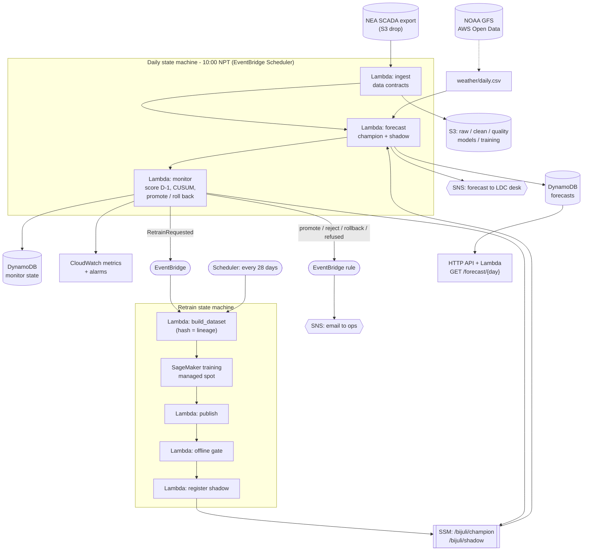

# Architecture

## What the system has to do

Every morning NEA's Load Dispatch Centre (LDC) decides how much power to buy from, or offer to, India's day-ahead market for tomorrow. Bids close at 12:00 IST (12:15 Nepal time). Bijuli's job is one forecast a day, issued at 10:00, for all 24 hours of tomorrow, with an honest uncertainty band and a cost-aware purchase basis. Then it has to keep that forecast good for years while demand grows, new industrial feeders connect and EVs spread, without anyone retraining it by hand and without ever letting a broken model buy power.

That shapes everything:

| Property | Consequence |
|---|---|
| One forecast a day, deadline 2 hours after data cut-off | Batch inference in a Lambda. No endpoint, nothing to keep warm |
| The consumer is a desk that bids once | Forecasts are stored and served by key; an API read is a DynamoDB `GetItem`/`Query` |
| Truth arrives one day later, every day | Daily scoring of yesterday's forecast is cheap and is the backbone of monitoring |
| Training takes about a minute on a year of hourly data | SageMaker training on spot, triggered rarely; no always-on training infrastructure |
| A wrong model costs money every hour it is champion | Promotion needs evidence from the serving path (shadow), and rollback must be one write |

## AWS (designed for ap-south-1, Mumbai)

Everything above is in [infra/template.yaml](../infra/template.yaml) (SAM). It passes `cfn-lint`, and every Lambda handler is tested against mocked AWS (moto) in [tests/test_aws_handlers.py](../tests/test_aws_handlers.py). **It has not been deployed to a real account.**

### The model lifecycle on AWS

| Step | Where | What decides it |
|---|---|---|
| Retrain requested | EventBridge Scheduler every 28 days, or `monitor_daily` emits `RetrainRequested` | Schedule, or CUSUM on daily bias crosses its threshold (ADR-004) |
| Dataset | `build_dataset` writes `training/issue_day=.../train.parquet` | Trailing 365 days of *clean* data only; content hash stored as lineage |
| Train | SageMaker `createTrainingJob.sync`, managed spot, `ml.m5.large` | `train_entry.py`: LightGBM quantile models + conformal calibration; writes the model card |
| Offline gate | `offline_gate` | Candidate's held-out MAPE must not be worse than what the champion actually delivered over the last 14 days |
| Shadow | `register_shadow` sets `/bijuli/shadow` | The forecast Lambda runs the challenger every day through the *serving* code; nothing it says buys power |
| Promote | `monitor_daily` after 7 shadow days | Shadow MAPE at least 3% lower than the champion's on the same days (or no worse while the champion is in a drift alarm) |
| Rollback | `monitor_daily`, 5 days after a promotion | The previous champion keeps forecasting in shadow; if the new champion is >15% worse, `/bijuli/champion` is written back |

Promotion and rollback are each a single `PutParameter` on a String parameter. Every function reads the pointer on each invocation, so there is no deployment, no alias shifting and no half-promoted state. The parameter history is the audit log.

### Why there is no canary

On a web endpoint, a canary sends 5% of requests to the new model. Bijuli has one consumer and one forecast a day: there is no traffic to split, and "5% of the hours" would make the purchase plan a mix of two models. Shadow mode is the batch equivalent: the challenger produces a complete forecast every day through the real serving path, scored on the same truth as the champion, with zero exposure. The replay showed this is not a technicality: the planted training-serving skew (a Fahrenheit weather feed in training only, bug #13) scored exactly like a clean model offline and was only visible in shadow. Shadow is not perfect either: in one policy a noisy shadow week let it through, and the rollback watch removed it 5 days later.

## Local equivalents

| AWS | Local (same code paths) |
|---|---|
| S3 + SSM + DynamoDB registry | `bijuli/registry.py` (JSON index + joblib files in `artifacts/registry`) |
| Daily state machine | `bijuli/ops.py` `Operator.run_day` |
| CloudWatch metrics and alarms | `bijuli/monitor.py` (CUSUM, PSI, daily scorecard) |
| SageMaker training | `QuantileForecaster.fit` in-process |
| SCADA feed | the grid twin (`bijuli/twin.py`) plus injected faults (`ops.inject_faults`) |

## Scaling

| If... | Then... |
|---|---|
| Forecasts per province or per substation (7 provinces, ~200 substations) | Same state machine with a `Map` state over regions; one global model with region features before 200 separate models. Training moves from 1 minute to ~10 on one instance, still spot |
| Intraday (hourly re-forecast) | Same Lambda on an hourly schedule; scoring stays daily. Still no endpoint: 24 batch runs a day is ~750 invocations a month |
| Real-time consumers (e.g. a market API polling) | They read DynamoDB through the HTTP API; the model is never on the request path |
| Training exceeds Lambda-friendly sizes | Already on SageMaker; switch instance type in one parameter |

## Going live

1. NEA LDC exports hourly SCADA load to an S3 bucket (or SFTP via AWS Transfer Family) by 09:30 daily. Ingest reads `raw/scada/date=YYYY-MM-DD/load.csv`.
2. A weather ingest Lambda (not built) writes `weather/daily.csv` from NOAA GFS on AWS Open Data: observed values for past days, the 00 UTC run for tomorrow.
3. `sam build && sam deploy --guided` with `AlertEmail`; seed `/bijuli/champion` with the model from `make train`.
4. Run in shadow-only mode for a month: the LDC desk keeps its own forecast and compares. Only then does the forecast feed a bid.
